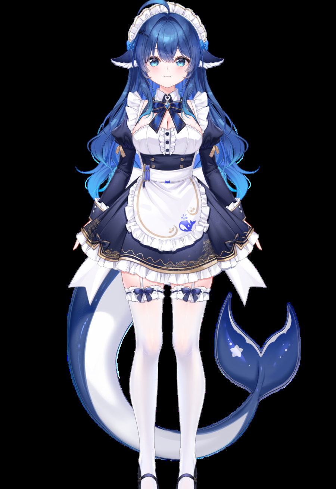

# live2dLumiPet · 流光桌宠（简称 lLP）

**English** · [English README](README.en.md)

> 一个把「VTube Studio 的精准驾驭」和「Live2DViewerEX 的桌面驻留」合起来的 Windows 桌宠：
> 真透明窗口 + 摄像头面部捕捉 + 模型原生热键 + 自定义模型导入。
---

把 **VTube Studio 的「精准驾驭」** 和 **Live2DViewerEX 的「桌面驻留」** 合成一个软件：
模型常驻桌面之上、真正透明、可穿透点击，同时用**摄像头面部捕捉**实时驱动，再用**模型自带的热键**触发预设表情和动作。

**支持导入自己的 Live2D 模型**（zip 直投），导入时自动完成热键与参数映射适配 —— 不绑定任何特定模型。

> ### ⚠️ 本项目不包含任何默认模型
>
> 仓库与发行包里都**没有**任何 Live2D 模型文件。程序首次启动会进入「无模型模式」：
> 桌宠窗口保持透明、控制台照常打开，到「模型」页导入一个 zip 即可开始使用。
>
> **开发测试用的模型**是 DeepSeek-chan / 大肥鱼 —— 它仅用于开发和演示，**不是**本项目的内置模型，
> 版权归原作者所有，不随本项目分发。获取方式见 B 站视频：
> <https://www.bilibili.com/video/BV1KmxY66EZ3>
>
> 拿到模型 zip 后，在「模型 → 选择 zip 导入」导入即可；导入时会自动适配热键与参数映射。
> 使用该模型请遵守其压缩包内的使用条款（禁止转售与二次上传）。



---

## 1. 它做了什么

### 桌面驻留（Live2DViewerEX 那一半）

| 能力 | 说明 |
|---|---|
| 真透明窗口 | `transparent` + WebGL alpha，只画出模型本身，其余像素完全透明（桌面图标能透出来） |
| 鼠标控制 | **开**：左键拖动、滚轮缩放、右键菜单都可用（逐像素命中——只有点到模型轮廓才响应，其余区域落到桌面）；**关**：整个窗口穿透，点击直接落到后面的界面 |
| 右键弹出窗口 | 开：右键模型弹出与托盘一致的菜单；关：右键不弹窗。需要「鼠标控制」为开 |
| 始终置顶 | 浮在普通窗口之上，可关闭 |
| 拖动 / 缩放 | 左键按住模型拖动位置；滚轮缩放 |
| 托盘常驻 | 托盘图标 + 右键菜单（打开控制台 / 隐藏 / 鼠标控制 / 右键窗口 / 置顶 / 缩放 / **重置模型状态** / 退出） |
| 重置模型状态 | 桌宠回到屏幕中心、取消所有表情与动作、缩放归 1 |
| 双击开控制台 | 双击模型打开控制面板 |
| 记忆状态 | 位置、缩放、透明度、所有设置都存到 `%APPDATA%/live2dLumiPet/config.json` |

### 控制台结构

侧栏六个页签，其中「设置」内部再按用途分成五组，避免选项堆在一起：

| 页签 | 内容 |
|---|---|
| 概览 | 运行状态、模型信息、键位速查、实时预览 |
| 面部捕捉 | 摄像头、镜像、平滑/死区、各轴幅度、注视范围、方向反转、校准 |
| **模型** | 导入 / 切换 / 删除模型，显示每个模型的表情·动作·热键·参数规模 |
| 快捷键 | 当前模型的热键 + 自定义热键 |
| 参数映射 | 当前模型的参数表逐项开关与改绑 |
| 设置 → 画面与渲染 | 渲染精度、裁剪蒙版精度、过渡时长、边缘光效、占位网格、调试浮层 |
| 设置 → 模型行为 | 待机动作、丢失追踪、呼吸、眨眼、物理演算、鼠标注视 |
| 设置 → 窗口与交互 | 鼠标控制、右键菜单、缩放、不透明度、置顶、虚拟桌面、任务栏、重置模型状态 |
| 设置 → 系统与启动 | **界面语言**、开机自启、托盘、版本与资源目录 |
| 设置 → 模型与数据 | 当前模型、重新加载、恢复默认、版权说明 |

### 界面语言

「设置 → 系统与启动 → 语言」可在 **简体中文 / 繁體中文 / English / 日本語** 四者之间切换，立即生效并保存到配置。

- 实现方式：src/shared/i18n.ts 里用**中文原文当 key**，界面写 ` t('渲染精度') `，字典缺条目就回落中文，所以永远不会出现空白文案。
- 覆盖范围：控制台全部界面、托盘菜单、窗口标题、桌宠 HUD、导入/切换/删除的提示与确认框。
- **不翻译**：来自模型文件的内容 —— 表情名、热键名、参数名、模型名、作者署名。这些是作者原文，翻译反而会让人对不上 VTube Studio 里的名字。
### 自定义模型导入

把模型文件夹压成 **zip** 拖进「模型」页导入即可，不需要手动改任何配置。

| 环节 | 做法 |
|---|---|
| 定位入口 | 在包内找 `.model3.json`（多个时取最浅的一个），相对它解析所有引用 |
| 资源归一化 | moc3 → `model.moc3`，贴图 → `textures/texture_NN.png`，动作/表情 → `mot-NN` / `exp-NN`，并重写 `model3.json`。中文/空格路径在这里被消化掉 |
| 表情 / 动作发现 | 先读 model3 的声明；**VTS 模型的动画通常不写进 model3**，所以再扫一遍目录把 `*.exp3.json` / `*.motion3.json` 全收进来 |
| 待机判定 | 目录名或文件名带 `idle` / `待机` 的归为 Idle 循环，其余是首次性 Action；一个都没有时把第一个动作当待机 |
| 热键适配 | 包内有 `.vtube.json` → 完整复用其中的 `Hotkeys`（含按键 token → Electron accelerator 转换）；没有 → 按表情自动生成 Alt+1…Alt+0/Q…P 的热键 |
| 参数映射适配 | 有 `ParameterSettings` 就照搬；没有就用 Cubism 标准参数表（头部/眼球/眨眼/嘴型/眉毛/身体/呼吸），并用 `cdi3.json` 按模型实有参数过滤 |
| 校验与提示 | 缺贴图、缺物理、热键引用的资源不存在等情况逐条返回，导入面板直接列出 |

删除模型只删用户目录里的文件；删掉正在用的模型会自动切到剩下的模型，一个都不剩时回到无模型模式。

### 精准驾驭（VTube Studio 那一半）

| 能力 | 说明 |
|---|---|
| 面部捕捉 | MediaPipe FaceLandmarker：478 关键点 + 52 组 ARKit 风格表情系数 + 4×4 头部姿态矩阵 |
| 参数映射 | **原样复刻**模型 `.vtube.json` 里的 `ParameterSettings` 表（40 条），含输入/输出区间、平滑、反向区间 |
| 头部姿态 | 摇头 / 点头 / 歪头 → `AngleX` / `AngleY` / `AngleZ`（模型作者自建的 OX/OY/OZ 装配参数） |
| 眼球 & 眨眼 | 虹膜关键点算视线 → `ParamEyeBallX/Y`；blendshape 眨眼 → `ParamEyeLOpen/ROpen` |
| 口型 | `jawOpen` → `ParamMouthOpenY` / `JawOpen`；微笑、鼓脸、撅嘴、吐舌、抿嘴等也接了 |
| 中性校准 | 「正坐并开始校准」采样 2 秒，把当前头部角度记为中立位 |
| 响应调校 | 平滑、死区、左右/上下/歪头/视线/口型幅度、三轴方向反转 |
| 自动兜底 | 没开摄像头时用**鼠标注视**（以模型双眼中心为枢轴，真正"看向鼠标"）+ 自动眨眼；人脸丢失超时后回落 |
| 表情叠加 | 自己实现的**多表情混音器**：可同时开多个表情、各自淡入淡出（pixi-live2d-display 原生只支持单表情） |
| 动作播放 | 交叉淡入的一次性动作；`IDLE` 待机循环；丢失追踪时播「脱捕」 |

### 快捷键

模型压缩包里的 `.vtube.json` 记录了作者配好的热键，程序**自动解析并注册为系统级全局热键**（桌宠不在前台也生效）：

| 热键 | 功能 | 热键 | 功能 |
|---|---|---|---|
| `Alt + 1` | 兔牙 | `Alt + Q` | 单片眼镜 |
| `Alt + 2` | 加载 | `Alt + W` | 脱鞋 |
| `Alt + 3` | 圈圈眼 | `Alt + E` | 钢盆 |
| `Alt + 4` | 屑屑眼 | `Alt + R` | 裙子长短 |
| `Alt + 5` | 流泪 | `Alt + T` | 黑框眼镜 |
| `Alt + 6` | 爱心眼 | `Alt + S` | 流冷汗 |
| `Alt + 7` | 脸红 | `Shift + 1` | 尾巴开关 |
| `Alt + 8` | 黑脸 | `Shift + 2` | 体型 1 |
| `Alt + 9` | ＞＜ | `Shift + 3` | 体型 2 |
| `Alt + Z` | 抚胸手打开 | `Shift + 4` | 默认体型 |
| `Alt + X` | 抚胸手关闭 | `Shift + 5` | 前倾 |
| `Alt + C` | 竖手指打开 | `Shift + S` | 胸口衣服 |
| `Alt + V` | 竖手指关闭 | `Alt + Delete` | **清除所有表情** |
| `Alt + D` | 狗尾巴草打开 | | |
| `Alt + F` | 狗尾巴草关闭 | | |

> 上表是**测试模型**（DeepSeek-chan）自带的示例热键；换成别的模型后，这里会自动变成那个模型的热键。
> VTube Studio 里的 `N1`~`N9` 在这里按**主键盘数字键**解释（绝大多数人就是这么按的）。
> 全部 28 条都可以在「快捷键」页改键 / 停用，还能**自建**新热键（模型库里任意表情或动作 → 任意组合键）。

---

## 2. 快速开始

### 直接运行（免安装绿色版）

```bash
npm install
npm run build            # 需要联网下载 Cubism Core 与 MediaPipe 模型，会缓存在 .cache/
npm run package          # 产出 release/live2dLumiPet-win32-x64/
release/live2dLumiPet-win32-x64/live2dLumiPet.exe
```

### 开发运行

```bash
npm install
npm run build            # assets + 主进程 tsc + 渲染层 vite
npm start                # 等价于 build + electron .
```

### 第一次使用

1. 启动后托盘里出现图标，控制台窗口打开（此时是**无模型模式**：桌宠窗口透明、不渲染任何东西）。
2. 先导入模型：「模型」页 → 「选择 zip 导入」→ 选一个 Live2D 模型压缩包 → 导入完成后自动启用。
   （还没有 zip？见上面「本项目不包含任何默认模型」一节。）
3. 「面部捕捉」页 → 打开「启用摄像头捕捉」→ 允许摄像头。
4. 面朝摄像头坐好 → 点「正坐并开始校准」→ 保持不动约 2 秒 → 点完成。
5. 回到桌面，按 Alt + 1 试试模型自带的第一个热键。

导入效果（这里用的是另一个完全不同的模型，未经任何手工配置）：


---

## 3. 工程结构

```
live2d/
├─ assets/
│  ├─ model-src/                   自备模型的原始目录（不入库；没有时构建会自动跳过）
│  └─ test/portrait.jpg            自检用的人脸图
├─ scripts/
│  ├─ prepare-assets.mjs           下载 Cubism Core / MediaPipe，并把模型归一化成 ASCII 资源树 + manifest
│  ├─ package-portable.mjs         打包绿色版
│  ├─ make-icons.py                从 AI 原创素材裁出托盘/品牌图标（与任何模型文件无关）
│  └─ dl-test-face.mjs             下载自检人脸图
├─ public/                         构建期生成的静态资源（vendor / model / 图标）
├─ src/
│  ├─ main/                        主进程
│  │  ├─ index.ts                  生命周期、单实例、开机自启、GPU 开关
│  │  ├─ protocol.ts               app:// 自定义协议（bundle / user 两个根）
│  │  ├─ windows.ts                桌宠窗口（透明/置顶/拖动/穿透）与控制台窗口
│  │  ├─ shortcuts.ts              globalShortcut 注册 + 冲突检测
│  │  ├─ tray.ts                   托盘与右键菜单
│  │  ├─ ipc.ts                    IPC 契约
│  │  ├─ store.ts                  配置持久化 + 模型目录解析 + 旧版目录迁移
│  │  ├─ zip.ts                    极简 ZIP 读取器（无第三方依赖，兼容 GBK 文件名）
│  │  ├─ importer.ts               自定义模型导入：归一化资源树 + 自动适配热键/参数映射
│  │  └─ smoke.ts                  端到端自检
│  ├─ preload/index.ts             contextBridge 暴露 window.petAPI
│  ├─ shared/                      主/渲染共用：类型、配置默认值、热键工具
│  └─ renderer/
│     ├─ pet/                      桌宠渲染层
│     │  ├─ main.ts                编排：模型、追踪、表情、动作、指针、状态上报
│     │  ├─ Stage.ts               PIXI 舞台 + 自驱动 rAF 循环 + 像素读回
│     │  ├─ params.ts              TrackingLayer（参数映射） + ExpressionMixer（表情叠加）
│     │  └─ FaceTracker.ts         MediaPipe 封装（人脸 → FaceFrame）
│     └─ control/                  React 控制台（概览/面部捕捉/快捷键/参数映射/设置）
└─ tests/core.test.mjs             单元测试（热键转换、配置合并、热键解析）
```

### 关键技术点

**1. 为什么用 `app://` 自定义协议？**
`file://` 下的 `fetch`/XHR 会被 Chromium 拦掉，Live2D 的 `model3.json` / `moc3` 根本加载不了。
自定义协议统一了 origin（纹理不会污染 WebGL 画布），且开发与打包后行为完全一致。

**2. 参数写入时机**
`pixi-live2d-display` 的 `Cubism4InternalModel.update()` 内部是：
`motion → saveParameters → expression → eyeBlink → focus → breath → physics → pose → beforeModelUpdate → model.update()`。
我们在 `afterMotionUpdate` 事件里写入追踪参数与表情（**在物理演算之前**），因此头发/裙子的物理会跟着追踪一起动；
同时关掉了 SDK 自带的 `eyeBlink`，眨眼改由我们统一控制，避免互相覆盖。

**3. 逐像素鼠标穿透**
`setIgnoreMouseEvents(true, { forward: true })` + `gl.readPixels` 读光标处 1 像素的 alpha，
> 0 才切回可交互。但实测发现**部分 Windows 环境下 `forward: true` 并不会转发 mousemove**，
> 窗口一旦进入穿透态就再也收不到鼠标事件（"逐像素命中"永远等不到第一次探测）。
> 所以现在由主进程以 30Hz 轮询 `screen.getCursorScreenPoint()`，换算成窗口内 CSS 坐标推给渲染层，
> 这条通道同时也是"鼠标注视"的数据来源。

**4. 表情层三条硬规则**

1. 基线取**模型参数默认值**（`getParameterDefaultValue`），不是 0。
   这个模型的 `Clothes1`(裙子) / `Clothes5`(尾巴) 默认都是 1，一律写 0 会让尾巴消失、裙子换成错的那条。
2. **没有表情占用某参数时一个字都不写**，否则会盖掉动作层（motion）刚写进去的值。
3. 同一参数被多个表情占用时**按激活顺序后者覆盖前者（带权重插值）**。
   体型1/体型2/默认体型是同一个 `Clothes2` 的三个档位（0.4 / 1 / 0），相加永远切不回去。

**5. 多表情叠加**
`pixi-live2d-display` 的 `ExpressionManager` 同时只能有一个表情；这里自己实现了一层：
每个表情按 `FadeIn/FadeOut` 独立升降权重，再按激活顺序逐参数覆盖合成，
所以「兔牙 + 脸红 + 爱心眼」可以同时开着，而「体型1 → 默认体型」这种互斥档位也能正确切换。

---

## 4. 自检与测试

```bash
npm test                 # 8 个单元测试
npx electron . --smoke   # 端到端：真实拉起窗口、加载模型、跑表情/动作/追踪、截图
```

`--smoke` 会依次验证并把结果写进 `smoke-out/result.json`：

- `model-loaded`：moc3 / 5 张 4096 贴图 / 物理 / 动作组 / 表情管理器
- `render-alpha`：模型中心 alpha=255、窗口角落 alpha=0（顺带证明穿透判定可用）
- `expression-on`：按下表情热键后 `key9` 参数确实变成 1
- `motion-play`：动作播放并回传当前动作名
- `tracking-drive`：喂入模拟人脸（X=20°/Y=-10°）后 `AngleX/AngleY` 真的被写进模型
- `drawable-probe`：715 个 drawable 的贴图索引全部落在 0~4

附加开关：

| 参数 | 作用 |
|---|---|
| `--diag` | 额外输出 part/drawable 诊断（排查渲染问题时用） |
| `--nose` | 定位"鼻子黑方块"：逐层隐藏 drawable 找出元凶并输出 |
| `--dump` | 导出开关类参数的定义范围/默认值/当前值 |
| `--ttest` | 用 `assets/test/portrait.jpg` 跑一遍 MediaPipe（不需要摄像头），验证 478 点 / 52 系数 / 姿态矩阵 |
| `--shot` | 只截图，不跑流程 |
| `--shot-control` | 逐个标签页截图控制台 |
| `--raw` | 不写任何参数，只加载模型（对照基线用） |
| `--opaque` | 用不透明背景启动桌宠窗口（排查透明窗口问题） |

实测结果（本机）：模型 3749×7697，5 张贴图，715 drawable，物理开启，60 FPS；
MediaPipe 前置人脸姿态 ≈ (1.5°, 3.0°, -0.6°)，镜像后 yaw 变号 → 矩阵列主序约定正确。

### 第二轮修复后的回归项

`--smoke` 里新增了以下断言，全部通过：

| 断言 | 含义 |
|---|---|
| `defaults-untouched` | 无表情时 `Clothes1=1` / `Clothes5=1`（裙子、尾巴保持模型默认） |
| `body-radio` | 体型1 → `Clothes2=0.4`；再按默认体型 → `0`；取消 → 回到 `0.4` |
| `skirt-toggle` / `tail-toggle` | 切换一次 `1→0`，再切回来 `0→1` |
| `no-param-fighting` | 表情层不覆盖动作层写过的 `Movement3` |
| `nose-clean` | 脸部区域纯黑像素数 = 0（黑方块已消除） |

---

## 5. 排错

| 现象 | 处理 |
|---|---|
| 点不到模型 / 拖动不了 | 确认「鼠标控制」是**开**的（开启时逐像素命中，只有点到模型轮廓才接收鼠标）；关闭后整窗穿透 |
| 托盘和控制台状态对不上 | 已修：两边读写同一份配置，且托盘改动会走和 IPC 相同的应用链路 |
| 热键没反应 | 「快捷键」页看状态列：`被其他程序占用` 说明被别的软件抢了（常见是 QQ / 输入法 / 录屏工具），点按键框改绑即可 |
| 摄像头打不开 / 检测不到脸 | 键盘上如果开了 **Windows 工作室效果（背景虚化）**，它会接管摄像头并对画面做处理，可能导致识别失败且明显卡顿 —— 到「设置 → 蓝牙和设备 → 摄像头」里关掉。同时看控制台「识别帧率」是否为 0 |
| 转头方向反了 | 「面部捕捉 → 方向反转」按需打开「左右 / 上下 / 歪头」 |
| 眨眼闭不死 / 瞪眼不明显 | 把「面部捕捉 → 睁闭眼幅度」调大（默认 1.2，可到 3） |
| 模型动得很拖沓 | 把「平滑」调小、「左右/上下幅度」调大 |
| 画面发糊 | 「设置 → 画面与渲染 → 渲染精度」调到 2×（或保持「自动」；手动调到 1.0 会明显变糊） |
| 尾巴根部/下巴/胸口/裙边 冒出光晕、边缘有阶梯块 | **根因是裁剪蒙版精度**：Cubism 默认把蒙版渲进 256×256 纹理，本模型画布 3749×7697，一个蒙版像素摊到屏幕约 2px，被裁的光效层就成了阶梯块。默认已改为 **1024**（加载时设置一次），边缘恢复正常；改这个值需要「重新加载模型」 |
| 想彻底去掉边缘光效 | 「设置 → 关闭边缘光效」把 `ArtMesh669_Skinning`（模型里名为「边缘反光」的那层）整个隐藏；只想变淡就用下面的强度滑杆（默认 35%） |
| 尾巴根部偶尔异常 / 裙摆自己乱晃 | 先试「设置 → 物理演算」关掉对比。物理已限制单帧步长（≤1/30s）防止掉帧过冲 |
| 桌宠窗口整窗看不见（虚拟机/远程桌面） | 用 `live2dLumiPet.exe --opaque` 先确认窗口层级；若是透明合成问题，可用 `--no-gpu-compositing` 或 `--software` 启动 |
| 想换模型 | 到「模型」页点「选择 zip 导入」，导入后点「使用」。也可以直接把 zip 拖进控制台 |
| 导入时报「没有找到 .model3.json」 | 这个 zip 不是 Live2D 模型，或者压缩包套了太多层 / 只放了贴图。确认里面有 `*.model3.json` 与 `*.moc3` |
| 导入后表情/动作为 0 | 模型没写进 model3 也没有散在目录里。检查包内是否有 `*.exp3.json` / `*.motion3.json` |
| 导入后热键对不上 | 包内没有 `.vtube.json` 时只能按表情自动生成 Alt+数字；可以在「快捷键」页手动改绑 |
| 导入的模型长得奇怪 / 参数不跟脸 | 该模型可能用非标准参数名。到「参数映射」页看有没有未映射项，或用「面部捕捉」页调各轴幅度 |

---

## 6. 版权与许可

- **项目作者**：吾名契白淮（B站） / Aley_Soler（GitHub） / DeepSeek（大肥鱼）
- **程序代码**：MIT（见 LICENSE）。模型与商标相关的说明单独放在 NOTICE。
- **Live2D 商标**：Live2D 是株式会社 Live2D 的商标。本项目为非官方作品，与其无隶属或合作关系。
- **本仓库不含任何模型文件**：所有 Live2D 模型均由用户自行导入。
- **测试模型（非内置、不分发）**：DeepSeek-chan / 大肥鱼，仅用于开发与演示，版权归原作者所有，
  获取方式见 B 站视频 <https://www.bilibili.com/video/BV1KmxY66EZ3>；使用需遵守模型压缩包内的
  *Terms of Use*（允许个人直播/视频/二创与调整模型设置；**禁止转售模型本体、禁止二次上传模型文件、禁止冒充作者**）。
  - 原画 / PSD 拆分：**Kamiya Ryoko（神宫凉子）**
  - Live2D 绑定：**霓虹猫_NeonNeko**
  - 公开使用作品时请标注上述出处与模型名。
- **用户导入的模型**：版权与使用限制归该模型作者，导入不改变其授权状态。
- **Live2D Cubism Core**：Live2D Inc. 所有，按 Cubism SDK 许可条款使用（程序在构建时从官方 CDN 拉取，不随源码分发）。
- **MediaPipe**：Google LLC，Apache-2.0。
- **其他依赖**：Electron（MIT）、pixi.js（MIT）、React（MIT）、pixi-live2d-display（MIT），各自遵循其许可。

---

## 7. 已知问题

> 以下几条与**测试模型**的具体图层有关，换模型后不一定复现。

- `前倾` 表情下下巴与阴影的交界处仍偏硬：属于模型自身的裁剪形状，非渲染问题。
- 边缘光效开关覆盖模型名为「边缘反光」的那一层（`ArtMesh669_Skinning`，5 个网格）。
  模型里还有 `ArtMesh668/670/675/678_Skinning` 四个同后缀 part，实测它们是**正常身体图层**（尾巴本体、裙摆等），
  一起隐藏会把整条尾巴删掉，因此没有归入这个开关。
- 下巴/胸口少量暖色描边是**基础画稿本身**的柔光，不受蒙版精度与光效开关影响（已做 A/B 验证）。
- 表情/动作的过渡时长默认 0.5s，可在「设置 → 过渡时长」整体缩放；个别动作在低 FPS 下观感略硬。
- 尚未实现：麦克风口型同步（参数表里的 `VoiceSilence` / `VoiceA~O` 已解析但无音频输入）、模型导入向导。
